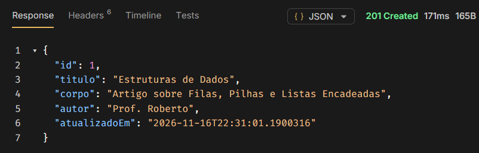
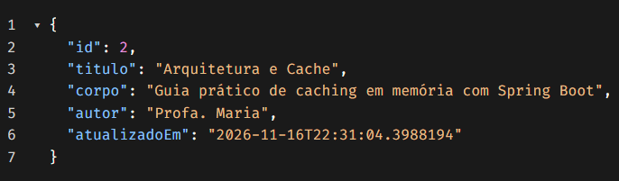
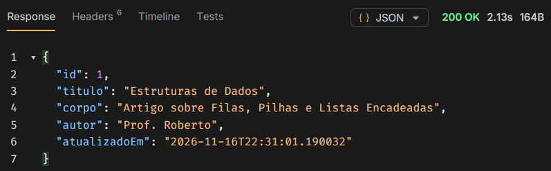
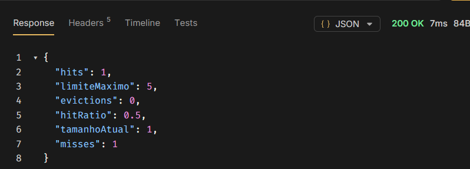
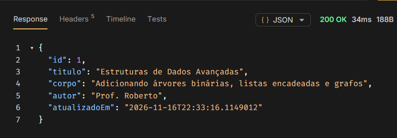
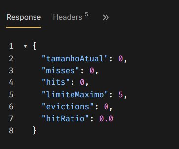
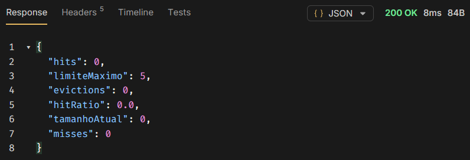

# Sistema de Cache em Memória (Light)

implementação de cache em memória. O objetivo é reduzir o tempo de resposta nas consultas de conteúdos, simulando um banco de dados lento (com um atraso proposital de 2 segundos) para deixar clara a diferença entre buscar no banco e buscar direto na memória.

---

## Como rodar o projeto

1. **Pré-requisitos:** Java 21 e Maven instalados na máquina.
2. **Clonar o repositório:**
   ```bash
   git clone <LINK_DO_REPOSITORIO>
   cd <PASTA_DO_PROJETO>

## Como o cache funciona no projeto
Toda a lógica de armazenamento fica isolada no componente ConteudoCache (@Component), que é acionado pela camada de Service antes de qualquer consulta ao banco de dados.

## Armazenamento e Concorrência: 
Os itens ficam guardados em um ConcurrentHashMap<Long, EntradaCache> para suportar requisições simultâneas sem problemas de concorrência. Cada entrada guarda o objeto Conteudo, o horário em que foi salva (armazenadoEm) e o horário da última vez que foi consultada (ultimoAcesso).

## HIT e MISS: 
Quando chega uma busca por ID, o Service verifica o cache primeiro. Se o item existe e ainda é válido (HIT), ele retorna na hora (~1 ms) com o header X-Cache: HIT. Se não existe (MISS), o Service simula a lentidão do banco (Thread.sleep(2000)), busca no H2, salva no cache e devolve com o header X-Cache: MISS.

## Limite e Remoção (LRU): 
O cache aceita no máximo 5 itens (app.cache.max-itens). Quando está cheio e entra um item novo, o algoritmo LRU (Least Recently Used) percorre as entradas, identifica qual tem o ultimoAcesso mais antigo e remove ela da memória (eviction) para abrir espaço.

## Expiração (TTL): 
Cada entrada dura 60 segundos (app.cache.ttl-segundos). Se alguém buscar um item depois desse tempo, o cache descarta a entrada expirada e trata a requisição como MISS, buscando o dado novamente no banco e renovando o cache.

## Invalidação: 
Sempre que um conteúdo é atualizado (PUT) ou removido (DELETE), a entrada correspondente é apagada do cache na hora para ninguém consumir dado desatualizado.

## Logs e Métricas: 
Toda consulta gera um log via SLF4J informando HIT ou MISS, o ID e o tempo em milissegundos, além de alimentar os contadores de estatísticas.

## Endpoints disponíveis
# POST /conteudos — Cadastra um novo conteúdo no banco.



## GET /conteudos/{id} — Busca um conteúdo passando pelo cache e retorna X-Cache: HIT ou MISS no header.

Estatistícas após:


## PUT /conteudos/{id} — Atualiza um conteúdo no banco e invalida o cache daquele ID.


## DELETE /conteudos/{id} — Remove um conteúdo do banco e invalida o cache.

## GET /cache/estatisticas — Mostra tamanho atual do cache, limite, hits, misses, evictions e hit ratio.


## DELETE /cache — Limpa todo o cache e zera os contadores.

## Estatistícas finais após a limpa de cache:
